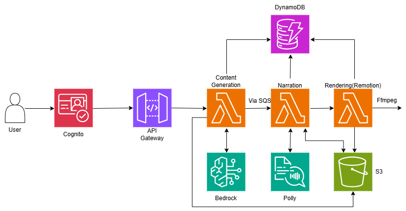
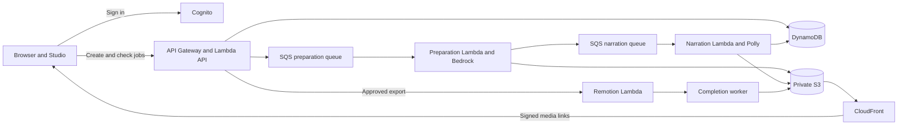

# Pragyan Studio

Pragyan Studio turns a topic or supplied material into a short, narrated visual explanation. You can edit the scenes, play them in the browser, and export a video with captions.

For example, a student could choose **Binary Search**, review an explanation that shows how the search range changes, and adjust the narration before sharing the video.

## How it works

1. **Start with a topic or material.** Enter a concept, paste text, or upload a text-based PDF.
2. **Prepare the scenes.** The app creates a script and visual instructions for each scene, then generates narration.
3. **Review and edit.** Change titles, narration, or visuals and preview the result in the browser. If you change the narration, regenerate its audio.
4. **Export when ready.** Approve the saved revision to create an MP4 and WebVTT captions.

The preview plays the scenes directly in the browser. Exporting creates a separate video file that can be downloaded and shared.

## Try it locally

You'll need Node.js 22.12 or newer and npm. On Windows, install an English system speech voice. On Linux or macOS, install `espeak` and make sure it is on your PATH. The first video render may download Chromium.

From the repository root, run:

```bash
npm ci
npm run dev
```

Open [http://localhost:3000](http://localhost:3000), choose **Open your studio**, and enter as **Maya** or **Arjun**. These are local demo identities with separate workspaces. The command starts the Studio, API, and worker together. Press `Ctrl+C` in the terminal to stop them.

To try a concept, choose **Explain a concept** and use the supplied network or binary search example. To try your own material, choose **Explain my material** and paste text or upload a text-based PDF.

Local mode uses prepared example scripts for the supported topics and extracts passages from supplied material. It does not call Bedrock to generate an explanation for an arbitrary topic. Narration and MP4 rendering run on your computer. AWS credentials and an `.env` file are not required for local mode.

For detailed setup and limits, see [STUDIO.md](STUDIO.md).

## AWS pilot architecture



The project also ran as a limited AWS pilot. The browser sent requests to an API, while separate workers prepared scenes and narration in the background.



Bedrock generated structured scene content, including narration and visual instructions. The preparation worker saved that content in S3 and recorded its location in DynamoDB. The narration worker retrieved it, used Polly to create audio, and saved the audio in S3. The browser checked job status and played the saved scenes with their audio. Remotion Lambda rendered approved exports to MP4.

SQS queues let the API hand longer work to independent workers. DynamoDB tracked job state and saved revisions. Cognito handled sign-in, and signed media URLs gave users temporary access to their files. The pilot limited concurrent work and did not establish high-traffic capacity. See the [architecture guide](docs/ARCHITECTURE.md) and [pilot record](docs/CLOUD-PILOT.md) for details.

The AWS pilot was shut down on November 1, 2026, at the user's request. Its cloud hosting and project resources were removed. Local development and previously downloaded example videos remain available. See the [shutdown record](docs/SHUTDOWN.md).

## Where to find the code

| Directory | Purpose |
| --- | --- |
| `apps/studio` | Next.js interface, editor, and browser preview |
| `services/api` | Express API and Lambda adapter |
| `services/core` | Job state, storage, quotas, and service adapters |
| `services/workers` | Scene preparation, narration, rendering, and recovery |
| `packages/schema` | Scene schemas, validation, and timing |
| `packages/video` | Remotion composition shared by preview and rendering |
| `infra` | AWS infrastructure defined with CDK |
| `tests` | Workflow and infrastructure checks |

The repository also contains the earlier Gyan Intent application under `frontend`, `backend`, and `whatsapp-bot`. Pragyan Studio uses the services listed above for its own workflow.

For more detail, see the [deployment guide](docs/DEPLOYMENT.md) and [cost notes](docs/COSTS.md).
