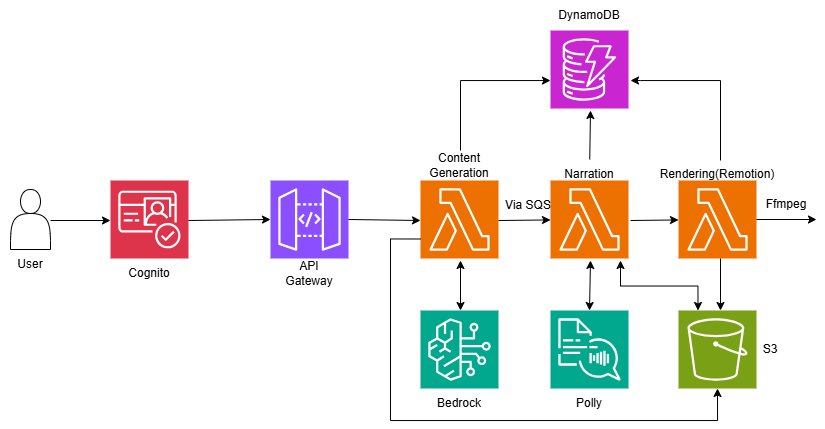

# Pragyan Studio

Pragyan Studio turns a concept or supplied material into an editable, narrated visual explanation. You can revise individual scenes, preview the animation, review source passages, and export a video with captions.

## AWS architecture



The AWS pilot uses Cognito for sign-in, API Gateway and Lambda for the application workflow, Bedrock for scene generation, Polly for narration, DynamoDB for job and revision state, S3 for media, and Remotion Lambda for rendering. Cloud exports are currently disabled after the approved pilot. See the [pilot record](docs/CLOUD-PILOT.md) for verified behavior and current limits.

## Run locally

Use Node.js 22.12 or newer and npm. On Windows, an English system speech voice is needed for local narration; on Linux or macOS, use `espeak`. The first video render may download Chromium.

```bash
npm ci
npm run dev
```

Open [http://localhost:3000](http://localhost:3000). The studio, Express API, and worker start together. No AWS credentials or `.env` file are needed for local mode.

Choose **Explain a concept** to try the supplied network or binary search examples, or **Explain my material** to work from pasted text or a text-based PDF. Local scene preparation uses authored example scripts or extracts from your material; it does not call Bedrock for arbitrary topics. Narration and MP4 exports are generated on your computer.

## Explore the workflow

1. Enter as Maya or Arjun, the two local demo identities with separate workspaces.
2. Create an explanation and wait for scene preparation and narration.
3. Preview and edit scenes, then save a revision. Regenerate audio after changing narration.
4. Review the script and supporting passages, approve the saved revision, and export the MP4 and WebVTT captions.

For setup details, limits, and commands, read [STUDIO.md](STUDIO.md). For implementation details, see the [architecture](docs/ARCHITECTURE.md), [deployment guide](docs/DEPLOYMENT.md), and [cost notes](docs/COSTS.md).
