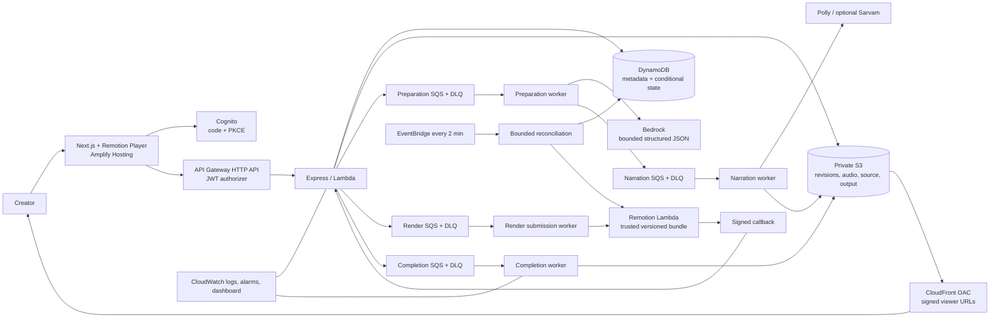
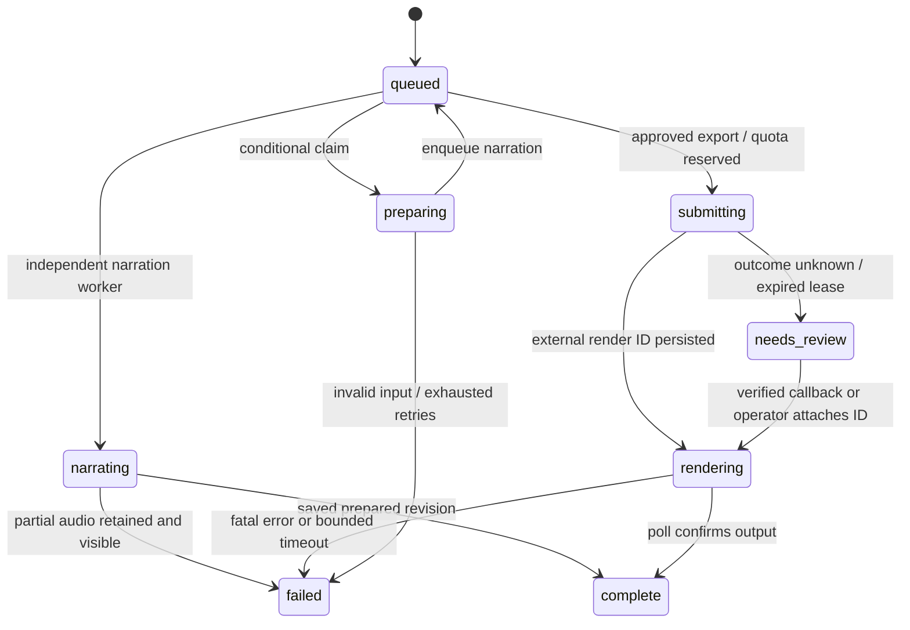

# Architecture and data model

## Service boundaries

AWS services solve specific needs: Lambda/Remotion pays for rendering only when invoked; SQS isolates long work and absorbs retries; DynamoDB provides durable conditional transitions and atomic quotas; S3 holds large, immutable artifacts; Cognito/API Gateway identify callers; CloudFront delivers private media; CloudWatch supports diagnosis; EventBridge repairs missed queue delivery/callbacks. No NAT Gateway, EC2, Kubernetes, RDS, or always-running container is present.

Express only validates/authenticates, reads/writes metadata, issues short-lived artifact access and enqueues work. It does not keep background jobs in memory or hold a request for rendering. Workers import the same business services, not HTTP routes. Local workers run in a separate process and consume durable queued rows from an atomic, locked file store.

## Persistent records

One DynamoDB table, on-demand capacity; key `id`. GSI `byOwner(owner)` lists an owner's records; GSI `byKind(kind)` supports the small experimental reconciliation workload. All authoritative reads use `ConsistentRead`; conditional writes use the `v` field. GSI listing is eventually consistent; job/project detail endpoints are authoritative.

| Kind / ID                                | Fields and purpose                                                                                                                          |
| ---------------------------------------- | ------------------------------------------------------------------------------------------------------------------------------------------- |
| PROJECT / UUID                           | owner, title, language, workflow, revision, immutable revisionKey, preparing/exporting job, timestamps, tombstone                           |
| JOB / UUID                               | owner, projectId, type, queue, stage, snapshotKey, revision, rendererVersion, attempts, lease, render identity, progress, output references |
| REVISION / `revision:project:n`          | owner, number and S3 reference for editor saves; prepared snapshots are also referenced by completed preparation jobs                       |
| REQUEST / owner + hashed idempotency key | request digest and original job, prevents replay charging twice                                                                             |
| USAGE / owner + UTC date                 | daily preparation/export reservations; failed attempts count                                                                                |
| ACTIVE / owner and SYSTEM                | per-user preparation/export and global export counters; updates are transactional with job transitions                                      |
| UPLOAD / hashed key                      | owner, declared size, readiness and one-day TTL                                                                                             |
| AUDIT / UUID                             | operator recovery event, timestamp and job ID                                                                                               |
| CLEANUP / project ID                     | durable artifact deletion work; SYSTEM-owned, completed marker expires after one day                                                        |

Scene documents, source passages, audio and videos stay in S3, not DynamoDB. Keys are scoped to owners/projects. Client-provided audio URLs are rejected; saved audio references are preserved only from a server-owned prior revision with a matching content fingerprint. Media is fetched only through the artifact adapter, not arbitrary LLM URLs.

Each export captures an immutable revision reference, narration keys, renderer version, render function and site URL. The revision's object is never overwritten. Editing creates a new object/revision and cannot mutate an active export. Pin and never overwrite a deployed renderer version; upgrades need a new version and explicit revision migration.

## Job lifecycle and failure windows

- Job + project + quota + idempotency records are committed together. Enqueue is best effort after the transaction. The durable `queued` row is an outbox; reconciliation re-enqueues it if needed.
- Duplicate SQS messages contend on the same conditional state/version and do not start another worker. Preparation/narration leases are 10 minutes; infrastructure timeouts are shorter. Retryable service failures get at most three phase attempts. Invalid model output/documents fail visibly.
- Audio is cached per project by text, language, selected provider/voice settings and renderer version. Each successful segment updates a new work snapshot. Retry only the failed scene or all stale scenes; unchanged audio is reused. A crash after audio storage but before the job checkpoint reuses the stored audio cache.
- A render submission is not exactly-once: there is no atomic transaction spanning DynamoDB and Remotion Lambda. A crash/network failure after submission but before saving its ID moves the job to `needs_review`, preserves the concurrency reservation and **does not resubmit**. A signed callback with the job ID can recover the external ID. Otherwise an operator must inspect Remotion/S3/logs before attaching an ID or releasing the reservation. The remaining duplicate-charge risk is an incorrect manual abandonment, documented rather than hidden.
- Callbacks require Remotion's HMAC signature, production mode, expected account/bucket and matching job/render version. They only trigger authoritative polling; callback output URLs are never trusted or fetched. Replays after completion are harmless. Scheduled polling also handles missing callbacks. Polling ends after an hour; Remotion's function timeout is four minutes.
- A successful completion transaction releases active counters once. Daily counts are not refunded, including failure, to constrain repeated expensive retries.
- Export reservation also conditionally updates the project record. Deletion checks this consistent record, so a delayed GSI cannot hide an active export. Deletion tombstones the project and writes a cleanup record atomically; reconciliation retries storage failures. Tombstoned projects reject all new access. CloudFront may retain an already cached object for an existing signed URL until that URL expires.

## Grounding, timing and providers

Text/PDF passages get stable IDs and optional page numbers. References must point to supplied passages; the model cannot create source text. The prompt treats source content as untrusted data. Scenes distinguish `source` from `explanation`. This validates provenance links, **not factual entailment**: human review is required before export.

Polly neural voices: Joanna (English), Kajal (Hindi). Other listed Indian languages route to an optional Sarvam adapter. A missing provider secret fails narration visibly; it does not switch to an English voice. Third-party charges are separate from AWS credits. Provider availability and output quality need live cloud verification.

One shared integer-frame timeline drives Player, export and VTT. Each narrated scene uses `ceil((measuredAudioSeconds + 0.3) × 24)`, minimum 48 frames. Subtitles are broken into readable groups and assigned proportional frame intervals. These are readable narration cues, not word-level forced alignment. Total duration is limited to 90 seconds. Fonts are bundled with the renderer and loaded before frames render.

## Security and operational limits

Cloud uses Cognito authorization-code + PKCE, HTTP API JWT validation, plus JWT issuer/client/token-use verification in Express. Every project/job/artifact route enforces owner equality. The cloud adapter never accepts local identities. Demo signup is disabled; an operator creates invited users. Access tokens are kept in browser sessionStorage (one hour); sign in again after expiry. A production hardening follow-up may use a same-origin BFF with HttpOnly cookies if persistent sessions are needed.

CloudFront uses OAC and a trusted signing key group. Until a real signing key is installed, the API uses short-lived private S3 URLs; it never publishes the bucket. Render assets expire after one hour, longer than the configured render/reconciliation expectation. Final downloads expire after 15 minutes. Private signed URLs remain bearer access until expiration; project deletion removes the underlying objects.

Worker IAM is limited to this table, media bucket, named queues and configured renderer/model. Polly requires `Resource:*` and is region-constrained. Operators should review the separate vendor-required Remotion execution-role policy before deployment. Logs contain job IDs, stages, token counts and durations, not source text or credentials. The initial reconciliation GSI design is intentionally for a small invited demo; high-volume operation should index active jobs by time/shard and add expiry for terminal metadata.

HTTP API access logs record request ID, route template, status and latency without request bodies, query strings or identity. A shared failed-job metric catches handled workflow failures that do not increment Lambda's exception metric. DLQ and Lambda-error alarms cover transport/runtime failures. Log retention is seven days.
